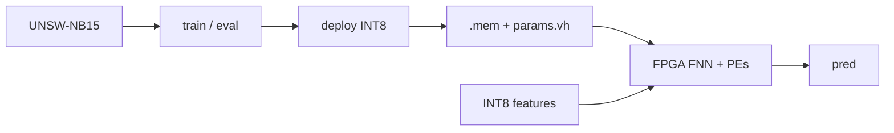

# FPGA-Accelerated Network Intrusion Detection

Train a small MLP on **UNSW-NB15**, quantize it to **INT8 Q1.7**, and run the
same network on an FPGA accelerator.

Default topology: **10 → 6 → 1** (binary: score ≥ 0 → attack).




## Repo layout

```
dataset/     UNSW-NB15 CSVs (download — see dataset/README.md)
sw/          train → eval (float) → deploy (quantize + export)
rtl/         FNN accelerator + AXI top
sim/         Icarus testbenches + golden vectors
weights/     exported .mem ROMs (after deploy)
artifacts/   float checkpoint + RFE feature list
docs/        architecture notes
```

## Setup

```bash
python3 -m venv .venv && source .venv/bin/activate
pip install -r requirements.txt          # runtime
pip install -r requirements-dev.txt      # ruff, pytest, pre-commit
make hooks                               # install git hooks
# Download UNSW-NB15 CSVs into dataset/ — see dataset/README.md
```

## Flow

```bash
make train      # float train → artifacts/nids_mlp.pt
make eval       # float test accuracy
make deploy     # quantize, INT8 check, write ROMs + fnn_params.vh
make golden     # full UNSW test set → sim/golden/
make lint       # Verilator RTL
make lint-py    # Ruff
make test       # pytest (Q1.7 / export unit tests)
make sim        # Icarus (needs iverilog)
```

Deeper net (same 10 RFE inputs):

```bash
make train-deeper && make deploy
```

Or any shape: `PYTHONPATH=sw python3 sw/train.py --layers 10,64,32,16,1`

## Design at a glance


|          |                                                                                    |
| -------- | ---------------------------------------------------------------------------------- |
| Data     | UNSW-NB15 binary (no `attack_cat`)                                                 |
| Features | RFE → 10                                                                           |
| Math     | INT8 Q1.7, shared MAC PEs                                                          |
| Host     | AXI4-Lite                                                                          |
| Depth    | change `--layers`, then `make deploy` (exact ROM size; ≤8 FC without editing `.v`) |


More detail (PE tiling, datapath): [docs/architecture.md](docs/architecture.md).

## Dev tooling


| Command                        | What                                           |
| ------------------------------ | ---------------------------------------------- |
| `make lint-py` / `make format` | Ruff check / auto-fix                          |
| `make test`                    | pytest unit tests                              |
| `make hooks`                   | install pre-commit                             |
| `make ci-smoke`                | synthetic 50-sample Icarus smoke (no UNSW CSV) |


CI (GitHub Actions): Ruff + pytest, Verilator lint, Icarus smoke. Dependabot keeps Actions/pip weekly.

## Acknowledgments

All RTL and Python in this repository were **written for this project**. We looked at public FPGA neural-net projects for **design ideas**:


| Project                                                                                                        | Idea we borrowed (in plain words)                                                                                                                  |
| -------------------------------------------------------------------------------------------------------------- | -------------------------------------------------------------------------------------------------------------------------------------------------- |
| [loonamanik/verilog_MNIST_accelerator](https://github.com/loonamanik/verilog_MNIST_accelerator)                | Keep the hardware as a **small fully connected network** run one layer at a time, so getting a first working demo is easier.                       |
| [ZFTurbo/…Digit-Detector…](https://github.com/ZFTurbo/Verilog-Generator-of-Neural-Net-Digit-Detector-for-FPGA) | Train in software, then **export fixed-point weights** into files the FPGA ROMs can load (train → quantize → Verilog-friendly memories).           |
| [mjao1/cnn-fpga](https://github.com/mjao1/cnn-fpga)                                                            | Use **signed Q1.7 (INT8)** arithmetic, and keep a clear split between **core accelerator RTL** and **board / host** glue (constraints, AXI, etc.). |


**Dataset:** [UNSW-NB15](https://research.unsw.edu.au/projects/unsw-nb15-dataset)
(Moustafa & Slay). Download steps: [dataset/README.md](dataset/README.md).
Use and cite according to the dataset authors’ terms.

## License

See [LICENSE](LICENSE).
