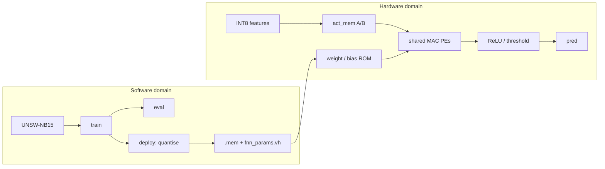
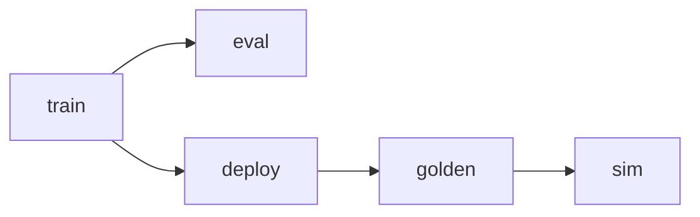
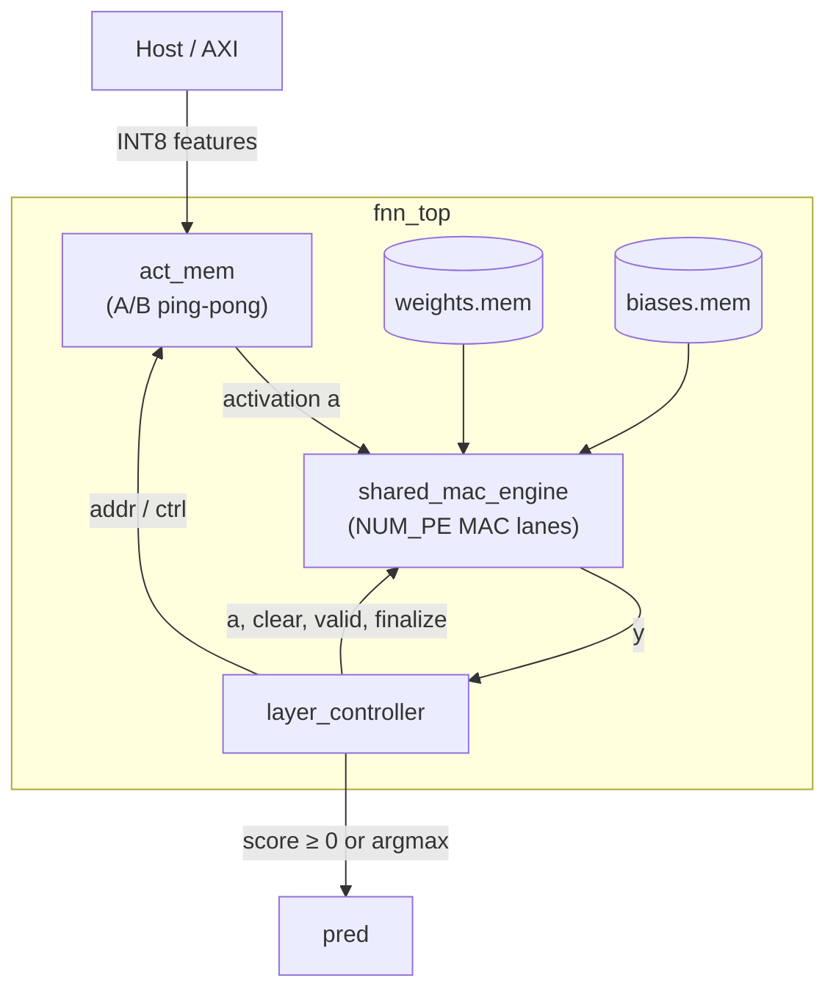

# System Architecture

## 1. Purpose and scope

This document describes the end-to-end architecture of an FPGA-accelerated
multi-layer perceptron (MLP) for binary (and optionally multi-class) network
intrusion detection. Floating-point training and evaluation are performed in
software on the [UNSW-NB15](https://research.unsw.edu.au/projects/unsw-nb15-dataset)
corpus. The trained model is quantised to signed **INT8 Q1.7** fixed-point
arithmetic and exported into synthesisable memory initialisation files. The
same numerical contract is then executed by a shared multiply–accumulate (MAC)
accelerator implemented in synthesisable Verilog.

The hardware path is intentionally limited to **inference**. Feature
extraction (including recursive feature elimination), packet capture, and
Ethernet parsing remain outside the FPGA datapath in the present revision.

Related documents (see also [`README.md`](README.md) in this folder):

| Document | Content |
| -------- | ------- |
| [`software.md`](software.md) | Training, quantisation, and export (`sw/`) |
| [`rtl.md`](rtl.md) | Verilog module map and reading order |
| [`simulation.md`](simulation.md) | Icarus verification and golden-vector contract |
| [`host.md`](host.md) | AXI4-Lite register map (`board/fnn_bench.py`) |
| [`synthesis.md`](synthesis.md) | Vendor tool and resource guidance |
| [`zcu104_bringup.md`](zcu104_bringup.md) | Zynq UltraScale+ ZCU104 implementation procedure |
| [`dataset.md`](dataset.md) | UNSW-NB15 acquisition and layout |

## 2. System overview



Software produces (i) a floating-point checkpoint, (ii) an INT8 reference
forward pass, and (iii) ROM images consumed by the FPGA. Hardware accepts a
vector of quantised features, evaluates the MLP layer by layer on a bank of
time-multiplexed processing elements (PEs), and returns a class identifier
together with an optional cycle count.

## 3. Learning problem and model topology

### 3.1 Default network

The default binary classifier has the following structure:

```
RFE → 10 features → Dense(6, ReLU) → Dense(1) → score ≥ 0 → attack
```

A non-negative final score is interpreted as the attack class (`pred = 1`);
a negative score is interpreted as benign (`pred = 0`). This threshold is
aligned with the software INT8 reference in `sw/model/quantize.py`
(`sw_int_forward`).

### 3.2 Configurable layer schedules

Layer widths are selected at training time via `--layers` and must be
re-exported with `make deploy` after any change.


| `--layers`      | Interpretation                                      |
| --------------- | --------------------------------------------------- |
| `10,6,1`        | Default binary classifier                           |
| `10,64,32,16,1` | Deeper binary classifier                            |
| `10,64,32,5`    | Multi-class classifier (hardware uses argmax)       |


Deployment regenerates `rtl/include/fnn_params.vh` and
`weights/generated/{weights,biases}.mem`. Memory depths `FNN_W_DEPTH` and
`FNN_B_DEPTH` are sized **exactly** for the active topology; no spare
headroom is reserved.

The `layer_controller` finite-state machine supports up to
**eight** fully connected layers without RTL edits (`FNN_MAX_LAYERS`).
Topologies beyond that bound require an extension of the controller’s
per-layer parameter tables.

## 4. Data preparation

Preprocessing is implemented in `sw/model/data_unsw.py` and proceeds as follows:

1. **Categorical encoding.** Non-numeric fields are label-encoded. Columns
   `id`, `label`, and `attack_cat` are removed from the feature matrix.
   Dropping `attack_cat` prevents label leakage into the binary task.
2. **Feature selection.** Recursive feature elimination (RFE) reduces the
   input to `input_dim` features (default 10). The selected feature list is
   cached under `artifacts/` for reproducibility.
3. **Standardisation.** A `StandardScaler` is fitted on the **training**
   partition only and applied to train and test splits.
4. **Fixed-point range mapping.** Features are clipped and scaled into
   \([-1, 1]\) so that they admit a faithful Q1.7 representation.

CSV locations and download instructions are given in
[`dataset.md`](dataset.md).

## 5. Software pipeline



| Stage | Command | Primary artefacts |
| ----- | ------- | ----------------- |
| Floating-point training | `make train` | `artifacts/nids_mlp.pt` |
| Floating-point evaluation | `make eval` | Test-set accuracy (console) |
| Quantisation and export | `make deploy` | `weights/generated/*.mem`, `fnn_params.vh` |
| Golden-vector generation | `make golden` | `sim/golden/` (UNSW test set, INT8) |
| RTL simulation | `make sim` | Icarus pass/fail vs software INT8 |

Quantisation converts each dense layer’s weights and biases to signed INT8
and validates that the software INT8 forward pass remains consistent with the
intended decision rule. The golden generator then evaluates that same INT8
model on every test sample (or a configured subset) and writes features,
expected predictions, and ground-truth labels for hardware comparison.

## 6. Fixed-point arithmetic (Q1.7)

Unless otherwise noted, activations, weights, and biases are **signed 8-bit**
values with seven fractional bits (Q1.7). Products therefore lie in a Q2.14
domain and are accumulated in a wider signed register (`FNN_ACC_W`, typically
32 bits). The PE finalisation sequence is:

1. \( \mathrm{acc} \leftarrow \mathrm{acc} + a \cdot w \) for each input index;
2. \( \mathrm{acc} \leftarrow \mathrm{acc} + (b \ll 7) \) to align the bias;
3. \( y \leftarrow \mathrm{sat}_{[-128,127]}(\mathrm{acc} \gg 7) \).

Hidden layers apply a ReLU nonlinearity after saturation. The output layer
does not. Binary decisions use \( y \ge 0 \); multi-class decisions use
argmax over the output vector.

## 7. Hardware organisation

### 7.1 Module hierarchy

| Region | Modules | Role |
| ------ | ------- | ---- |
| `rtl/accel/` | `fnn_top`, `layer_controller`, `shared_mac_engine`, `mac_unit`, `act_mem`, `weight_mem`, `relu`, `argmax` | Inference datapath and scheduler |
| `rtl/peripheral/` | `fpga_top`, `axi4lite_slave` | Board-facing AXI4-Lite wrapper |
| `rtl/include/` | `fnn_params.vh` | Auto-generated geometry and register offsets |

`fpga_top` instantiates `fnn_top` and `axi4lite_slave`. Simulation benches
instantiate `fnn_top` (or `mac_unit`) directly and do **not** exercise the AXI
slave; on-board bring-up uses the peripheral path described in
[`zcu104_bringup.md`](zcu104_bringup.md).

### 7.2 Accelerator datapath



Two activation memories (**A** and **B**) implement a ping-pong buffer:
layer \(n\) reads from one bank while writing layer \(n\) outputs into the
other. Weight and bias memories are read-only ROMs initialised from the
exported `.mem` files. The `layer_controller` issues addresses, PE enables,
and handshake signals; the `shared_mac_engine` broadcasts a single activation
sample to `FNN_NUM_PE` MAC lanes, each with a distinct weight (and, at bias
time, a distinct bias).

### 7.3 Processing-element tiling

When a layer’s output width exceeds `FNN_NUM_PE`, the controller evaluates the
layer in successive **tiles**. For the default geometry \(10 \rightarrow 6\)
with `NUM_PE = 4`:


| Pass   | PE0   | PE1   | PE2     | PE3     |
| ------ | ----- | ----- | ------- | ------- |
| Tile 1 | out 0 | out 1 | out 2   | out 3   |
| Tile 2 | out 4 | out 5 | *(off)* | *(off)* |


Within a tile, for every input index \(i\):

- the activation \(x[i]\) is presented to every **enabled** lane;
- lane \(k\) computes \( \mathrm{acc}_k \mathrel{+}= x[i] \cdot W[\mathrm{out}_k][i] \).

After the input sweep, each enabled lane adds its bias, finalises to INT8,
applies ReLU when the layer is hidden, and writes results into the destination
activation bank. The controller then advances to the next tile or the next
layer.

### 7.4 Controller scheduling (summary)

Synchronous RAM reads require a three-phase access (`REQ` → `WAIT` → `CAP`).
Consequently the controller interleaves memory latency with MAC issue. At a
high level, one tile proceeds as: clear accumulators; for each input, fetch
activation and per-lane weights then pulse `valid`; fetch biases; finalise;
capture `y`; write back; advance. Terminal states produce `pred` and assert
`done`. Detailed state names are defined in `rtl/accel/layer_controller.v`.

## 8. Host interface (summary)

The on-chip control and status interface is an **AXI4-Lite** slave with
32-bit address and data ports. Register decode uses address bits `[7:0]`;
upper bits select the memory-mapped window assigned in the SoC address map.
The host loads features via `ADDR`/`DATA`, pulses `CTRL`, polls `STATUS`, and
reads `PRED` (and optionally `CYCLES`). The complete map and programming
sequence appear in [`host.md`](host.md).

## 9. Board integration

Recommended bring-up order:

1. `make train && make deploy` (see [`software.md`](software.md))
2. `make golden && make sim` (see [`simulation.md`](simulation.md))
3. ZCU104 bitstream → SD → `make board-run`
   ([`zcu104_bringup.md`](zcu104_bringup.md))
4. MMIO programming sequence ([`host.md`](host.md))

General synthesis remarks: [`synthesis.md`](synthesis.md).
