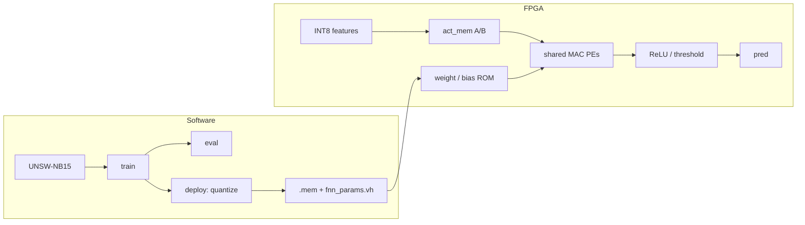
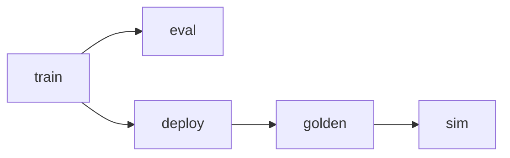
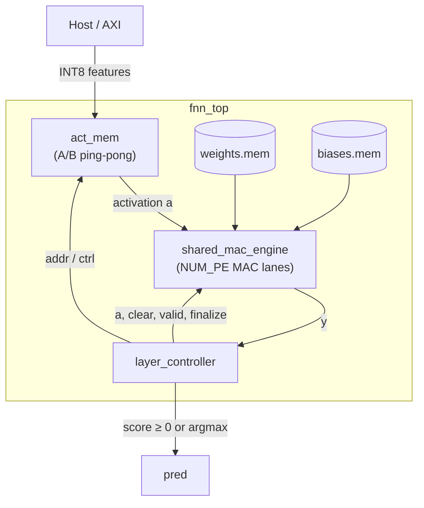

# Architecture

FPGA inference for an MLP-based network intrusion detector. Train in float;
the chip runs the same math in INT8 Q1.7.

## Overall




## Model

```
RFE → 10 features → Dense(6, ReLU) → Dense(1) → score ≥ 0 → attack
```


| `--layers`      | Meaning              |
| --------------- | -------------------- |
| `10,6,1`        | default binary       |
| `10,64,32,16,1` | deeper binary        |
| `10,64,32,5`    | multi-class (argmax) |


A new shape always needs **retrain +** `make deploy`: that rewrites
`fnn_params.vh` and the `.mem` ROMs. Memories are sized **exactly** for the
current net (`FNN_W_DEPTH` / `FNN_B_DEPTH`) — no spare headroom.

The `.v` FSM stays the same within **8** FC layers. Beyond that, extend
`layer_controller`.

## Data prep

`sw/model/data_unsw.py`:

1. Label-encode categoricals; drop `id`, `label`, and `attack_cat` (label leak)
2. RFE to `input_dim` features (cached under `artifacts/`)
3. `StandardScaler` fit on **train only**
4. Clip / scale into `[-1, 1]` for Q1.7

CSVs live in `dataset/` (download instructions: `dataset/README.md`).

## Software pipeline




| Step              | Command       | Output                                     |
| ----------------- | ------------- | ------------------------------------------ |
| Train             | `make train`  | `artifacts/nids_mlp.pt`                    |
| Float eval        | `make eval`   | test accuracy                              |
| Quantize + export | `make deploy` | `weights/generated/*.mem`, `fnn_params.vh` |
| Golden            | `make golden` | `sim/golden/` (full UNSW test set)         |


## Hardware datapath




### How PEs are used (example: layer 10→6, `NUM_PE=4`)

Only **4** MAC lanes, but the layer has **6** outputs, so the controller does
two passes (“tiles”):

| Pass | PE0 | PE1 | PE2 | PE3 |
|------|-----|-----|-----|-----|
| Tile 1 | out 0 | out 1 | out 2 | out 3 |
| Tile 2 | out 4 | out 5 | *(off)* | *(off)* |

On each pass, for every input `x[0]…x[9]`:

- the same `x[i]` goes to every **enabled** PE
- PE *k* does `acc_k += x[i] * W[out_k][i]`

Then add bias, `>>7`, ReLU (hidden), write results, start the next tile.

**MAC math:** `acc += a*w` → `acc += bias<<7` → `y = sat(acc>>7)`.

## Board bring-up

1. `make train && make deploy`
2. `make golden && make sim`
3. Synth `fpga_top` (see `scripts/synth_notes.md`); host talks AXI MMIO
