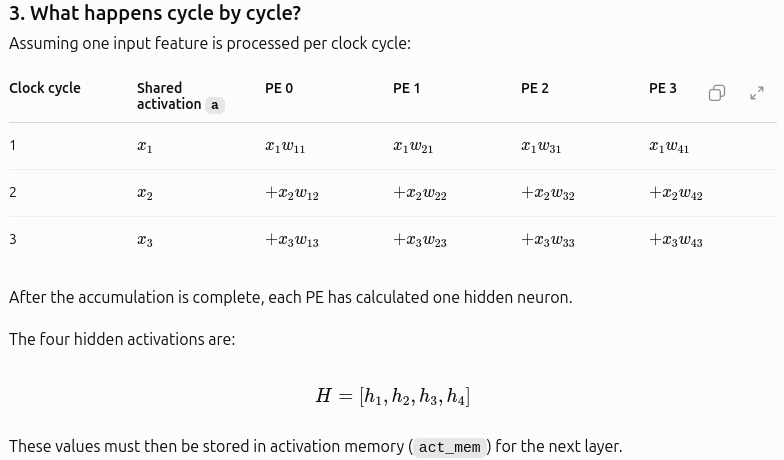

# Register-Transfer Level (`rtl/`)

## 1. Overview

Synthesisable Verilog for the fully connected neural-network (FNN) inference
accelerator and its AXI4-Lite board wrapper. Geometry and memory depths come
from the auto-generated header `rtl/include/fnn_params.vh`

## 2. Directory structure

| Path                | Purpose                                                             |
| ------------------- | ------------------------------------------------------------------- |
| `rtl/accel/`      | Datapath: memories, MAC engine, layer scheduler, `fnn_top`        |
| `rtl/peripheral/` | Host integration: `axi4lite_slave`, `fpga_top`                  |
| `rtl/include/`    | `fnn_params.vh`: widths, layer geometry, ROM depths, MMIO offsets |
| `rtl/filelist.f`  | Ordered file list (paths relative to repository root)               |

### 2.1 Accelerator modules (`accel/`)

| File                    | Function                                                                                                                                                    |
| ----------------------- | ----------------------------------------------------------------------------------------------------------------------------------------------------------- |
| `mac_unit.v`          | A single signed INT8 multiply-accumulate (MAC) unit with an INT32 accumulator, followed by fixed-point rescaling and saturation to the target output range. |
| `shared_mac_engine.v` | `FNN_NUM_PE` parallel MAC lanes with shared activations and lane-specific weights and biases.                                                             |
| `act_mem.v`           | Synchronous activation RAM (host load + ping-pong)                                                                                                          |
| `weight_mem.v`        | Read-only weight/bias ROM (`$readmemh`)                                                                                                                   |
| `relu.v`              | ReLU for hidden-layer write-back                                                                                                                            |
| `argmax.v`            | Argmax over scores (multi-class)                                                                                                                            |
| `layer_controller.v`  | FSM: tiles, layers, memory sequencing, decision                                                                                                             |
| `fnn_top.v`           | Structural composition of memories, engine, controller                                                                                                      |

#### 2.1.1 fnn_top.v

This is the top-level Verilog module of the FPGA-based neural network accelerator. Its job is to connect all the hardware components together:

- Activation memories: store intermediate neuron values.
- Weight and bias memories: store trained model parameters.
- Shared MAC engine: performs multiply-accumulate operations.
- Layer controller: controls the order of neural network computations.
- Input and output interface: communicates with the processor.

#### 2.1.2 act_mem.v

- The activation memory (act_mem) is implemented as a parameterized, synchronous simple dual-port memory with one write port and one read port.
- Its main purpose is to store intermediate activation values between neural network layers and provide them to the computation unit when needed.
- The memory is organized as an array of DEPTH locations, with each location storing a signed activation value of DATA_W bits. - - The ADDR_W parameter determines the address width required to access individual memory locations.
- Separate read and write addresses allow the memory to perform read and write operations within the same clock cycle.
- A write-enable signal (we) controls memory updates, while the read operation is performed synchronously on every rising clock edge.
- All memory locations are initialized to zero.
- Depending on the configured memory dimensions and FPGA synthesis, the memory can be mapped to Block RAM (BRAM) or distributed RAM (LUTRAM).

Note: If both addresses point to the same location, the RTL code reads the old value because non-blocking assignments update the memory after evaluating the right-hand sides.

#### 2.1.3 weight_mem.v

- The weight_mem module implements a synchronous, read-only memory (ROM) for storing the trained weights and biases of the FNN.
- The memory is initialized using a hexadecimal .mem file generated by the software deployment pipeline through export_weights.py.
- The stored parameters are organized layer by layer in row-major order, with weights arranged according to output and input neurons, followed by the corresponding bias values.
- The memory uses configurable parameters for data width, memory depth, and address width.
- The ram_style = "block" attribute guides Vivado to infer Block RAM (BRAM) for storage.
- The read operation is synchronous and occurs at the rising edge of the clock.

#### 2.1.4 shared_mac_engine.v

- The shared_mac_engine module implements a parallel Multiply-Accumulate (MAC) engine for your FNN FPGA accelerator.
- It instantiates multiple mac_unit modules operating in parallel. All MAC units receive the same activation input (a), but each lane receives its own weight and bias values. This allows the accelerator to calculate multiple output neurons simultaneously.
- For example, if NUM_PE = 4, four MAC units can process four different output neurons in parallel using the same input activation and four different weights.



#### 2.1.5 mac_unit.v

- The mac_unit is the module that performs the actual multiply-accumulate (MAC) operation for one processing element (PE).
- It receives an activation and its corresponding weight, multiplies them, adds the result to a 32-bit accumulator, and optionally adds a bias.
- When finalize is asserted, it converts the accumulated result back to the INT8 output range using a fixed-point right shift and saturation.
- Here, each PE has its own mac_unit, so each PE maintains an independent accumulator.

#### 2.1.6 relu.v

- This relu module implements the ReLU (Rectified Linear Unit) activation function for a signed INT8 value.
- It can also bypass ReLU when enable=0, which is useful for an output layer that should not use ReLU.

#### 2.1.7 argmax.v

- This argmax module finds the index of the largest score among the neural network's output neurons.
- It is commonly used for classification, where each output neuron represents a class.

#### 2.1.8 layer_controller.v

- The layer controller coordinates the entire neural-network inference process.
- It acts as the brain of your FPGA accelerator: it decides which activation and weight to read, when to perform MAC operations, when to add biases, when to apply ReLU, and where to store the results.
- The controller uses a Finite State Machine (FSM) to coordinate the inference process.
- Activation, weight, and bias memories use synchronous reads. Therefore, the controller separates each memory operation into three stages: REQ (drive addr) → WAIT (mem samples) → CAP(use dout)

### 2.2 Peripheral modules (`peripheral/`)

| File                 | Function                                                   |
| -------------------- | ---------------------------------------------------------- |
| `axi4lite_slave.v`   | AXI4-Lite MMIO, feature write, start/status/pred/cycles    |
| `fpga_top.v`         | Instantiates `fnn_top` + AXI slave and optional debug ports|


#### 2.2.1 axi4lite_slave.v
- AXI4-Lite is a lightweight memory-mapped communication protocol used to connect hardware peripherals and processors.
- The AXI4-Lite slave acts as a bridge between software running on the ARM processor and hardware running inside the FPGA.
- It allows the processor to control the neural network accelerator using memory-mapped registers.
- Input features must be transferred from the ARM processor to the FPGA before inference can begin.
- The ARM processor used Memory-Mapped I/O (MMIO) to transfer.
- In MMIO, we assign specific addresses to hardware registers. The processor can access these registers using normal memory read and write operations.

AXI4-Lite has five independent communication channels:

| Channel | Signal prefix | Direction from master to slave | Purpose |
|---|---|---|---|
| Write Address | AW | Yes | Specifies the address to write |
| Write Data | W | Yes | Carries the data to write |
| Write Response | B | No | Reports the write transaction result |
| Read Address | AR | Yes | Specifies the address to read |
| Read Data | R | No | Returns the requested data |

For example,
| Register | Address offset | Access | Purpose |
|---|---:|---|---|
| CTRL | `0x00` | Write | Start inference |
| STATUS | `0x04` | Read | Read busy/done |
| PRED | `0x08` | Read | Read predicted class |
| CYCLES | `0x0C` | Read | Read execution cycles |
| ADDR | `0x10` | Write | Select feature/score index |
| DATA | `0x14` | Read/Write | Write features or read scores |

`Why AXI4 Slave ?`
- The neural network accelerator does not understand C instructions or software commands.
- It understands hardware signals such as: start, feat_we, feat_addr, feat_wdata
- The ARM processor, on the other hand, communicates through AXI transactions.
- Therefore, we need a component that translates between these two worlds.
- The AXI slave performs three major jobs:
    1. Receives input features from the processor.
    2. Starts and monitors neural network inference.
    3. Returns prediction results and performance information.

#### Understanding the AXI write transaction
Remember that AXI4-Lite has separate write-address and write-data channels.
These are:
- AW: Write Address.
- W: Write Data.
- B: Write Response.

An important detail is that the write address and write data can arrive independently.

For example, 
| Clock cycle | AWVALID | WVALID | What happens |
|---|---:|---:|---|
| 1 | 1 | 0 | Address arrives |
| 2 | 0 | 1 | Data arrives |
| 3 | 0 | 0 | Slave commits the write |
| 4 | 0 | 0 | Slave returns write response |

The slave must remember the address while waiting for the data, or remember the data while waiting for the address.

#### Understanding the AXI read transaction
A read transaction uses two channels:
- AR: Read Address.
- R: Read Data.
The sequence is simpler:
````mermaid
%%{init: {'theme': 'base', 'themeVariables': { 'actorBkg': '#1e293b', 'actorTextColor': '#f8fafc', 'actorBorder': '#38bdf8', 'signalColor': '#334155', 'signalTextColor': '#0f172a', 'labelBoxBkgColor': '#f1f5f9', 'labelBoxBorderColor': '#cbd5e1', 'labelTextColor': '#0f172a', 'noteBkgColor': '#e0f2fe', 'noteTextColor': '#0c4a6e', 'noteBorderColor': '#38bdf8'}}}%%
sequenceDiagram
    autonumber
    participant ARM as ARM Processor<br/>(AXI Master)
    participant AXI as AXI Slave<br/>(FNN Accelerator)

    rect rgb(241, 245, 249)
        Note over ARM, AXI: Read Address Channel (AR)
        ARM->>+AXI: ARADDR (Read Address)
        ARM->>AXI: ARVALID (Address Valid)
        AXI-->>-ARM: ARREADY (Address Ready)
    end

    rect rgb(240, 253, 244)
        Note over ARM, AXI: Read Data Channel (R)
        AXI-->>+ARM: RDATA (Read Data)
        AXI-->>ARM: RVALID (Data Valid)
        ARM->>-AXI: RREADY (Data Ready)
    end
````
- The processor requests an address, and the slave returns the corresponding register value.

````mermaid
%%{init: {'theme': 'base', 'themeVariables': { 'primaryColor': '#1e293b', 'primaryTextColor': '#f8fafc', 'primaryBorderColor': '#38bdf8', 'lineColor': '#64748b', 'secondaryColor': '#0f172a', 'tertiaryColor': '#1e293b'}}}%%
flowchart TB
    subgraph PS["Processing System (PS)"]
        direction TB
        App["<b>Application</b>"]
        ARM["<b>Zynq ARM Processor</b><br/><i>Memory-Mapped I/O Driver</i>"]
        
        App --> ARM
    end

    subgraph PL["Programmable Logic (PL)"]
        direction TB
        AXI{{"<b>axi4lite_slave</b><br/><i>Register File & Bus Interface</i>"}}

        subgraph Signals["Control & Data Registers"]
            direction LR
            Start(["<b>Start</b><br/><i>Trigger Pulse</i>"])
            Feat[/"<b>Feature Write</b><br/><i>INT8 Inputs</i>"/]
            Read(["<b>Read Results</b><br/><i>Status & Output Regs</i>"])
        end

        subgraph Top["<b>fnn_top</b> <i>(Accelerator Core)</i>"]
            direction LR
            ActRAM[("<b>Activation RAM</b><br/><i>Ping-Pong Buffer</i>")]
            Ctrl["<b>Layer Control</b><br/><i>FSM & Scheduling</i>"]
            MAC["<b>Shared MAC</b><br/><i>Parallel PEs</i>"]
            Post["<b>ReLU / Argmax</b><br/><i>Post-Processing</i>"]
        end

        Out[/"<b>Hardware Outputs</b>"/]

        %% Internal PL Connections
        AXI --> Start
        AXI --> Feat
        Read --> AXI

        Start --> Top
        Feat --> Top
        Top --> Read
        Top --> Out
    end

    %% PS to PL Bus
    ARM == "AXI4-Lite Bus" ==> AXI

    %% Styling
    classDef sw fill:#1e3a8a,stroke:#60a5fa,stroke-width:2px,color:#ffffff;
    classDef bus fill:#334155,stroke:#cbd5e1,stroke-width:2px,color:#ffffff;
    classDef reg fill:#312e81,stroke:#818cf8,stroke-width:2px,color:#ffffff;
    classDef core fill:#064e3b,stroke:#34d399,stroke-width:2px,color:#ffffff;
    classDef output fill:#7f1d1d,stroke:#f87171,stroke-width:2px,color:#ffffff;

    class App,ARM sw;
    class AXI bus;
    class Start,Feat,Read reg;
    class ActRAM,Ctrl,MAC,Post core;
    class Out output;

    style PS fill:#f8fafc,stroke:#cbd5e1,stroke-width:2px,color:#0f172a
    style PL fill:#f8fafc,stroke:#94a3b8,stroke-width:2px,color:#0f172a
    style Signals fill:#eef2ff,stroke:#c7d2fe,stroke-width:1px,color:#1e1b4b
    style Top fill:#ecfdf5,stroke:#6ee7b7,stroke-width:2px,color:#064e3b
````


#### 2.2.2 fpga_top.v
- It is the top-level integration module of the FPGA-based neural network accelerator.
- In Verilog, a top module is the main entry point of your hardware design.
- It connects the different modules and exposes the signals that communicate with external hardware.
- Think of it as the main circuit board that connects all the components.

````mermaid
%%{init: {'theme': 'base', 'themeVariables': { 'primaryColor': '#1e293b', 'primaryTextColor': '#f8fafc', 'primaryBorderColor': '#38bdf8', 'lineColor': '#64748b', 'secondaryColor': '#0f172a', 'tertiaryColor': '#1e293b'}}}%%
flowchart TB
    subgraph PL["Programmable Logic (PL)"]
        direction TB
        
        subgraph Top["<b>FPGA Top Module</b> (<code>fpga_top</code>)"]
            direction TB
            
            subgraph Core["Compute Core"]
                direction TB
                FNN["<b>fnn_top</b><br/><i>Top-Level Wrapper</i>"]
                Accel{{"<b>Neural Network Accelerator</b><br/><i>FNN Inference Datapath</i>"}}
                FNN --> Accel
            end

            AXI[["<b>axi4lite_slave</b><br/><i>AXI4-Lite Bus & Register Interface</i>"]]
        end
    end

    PS(["<b>Processing System</b><br/><i>ARM CPU</i>"])

    %% Connections
    Accel <--> AXI
    AXI <== "AXI4-Lite Bus" ==> PS

    %% Styling
    classDef fnn fill:#064e3b,stroke:#34d399,stroke-width:2px,color:#ffffff;
    classDef axi fill:#312e81,stroke:#818cf8,stroke-width:2px,color:#ffffff;
    classDef ps fill:#1e3a8a,stroke:#60a5fa,stroke-width:2px,color:#ffffff;

    class FNN,Accel fnn;
    class AXI axi;
    class PS ps;

    style PL fill:#f8fafc,stroke:#94a3b8,stroke-width:2px,color:#0f172a
    style Top fill:#f1f5f9,stroke:#64748b,stroke-width:2px,color:#0f172a
    style Core fill:#ecfdf5,stroke:#6ee7b7,stroke-width:1px,color:#064e3b
````


### 2.3 Generated parameters (`include/fnn_params.vh`)

This file is a **Verilog header file** containing configuration parameters for FPGA-based Feedforward Neural Network (FNN). It connects the software-trained neural network with the hardware implementation. The file contains configuration information exported from the software model by `sw/model/export_weights.py` during `make deploy`. Manual edits are discarded.

Compile order for tools that need an explicit list: `rtl/filelist.f`.
