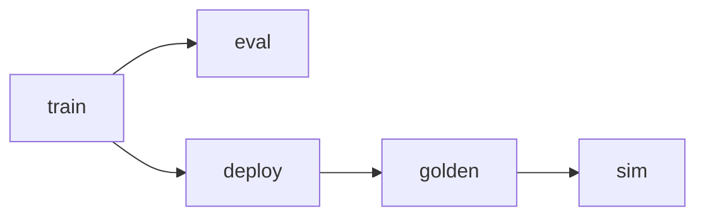

# Software Pipeline (`sw/`)

## 1. Purpose

The software stack trains a floating-point MLP, evaluates it, quantises
weights and activations to signed INT8 Q1.7, exports FPGA ROM images and
`fnn_params.vh`, and (via `generate_test_vectors.py`) builds golden vectors
for RTL simulation. Hardware and software share one numerical contract
implemented in `sw/model/quantize.py` (`sw_int_forward`).

Related documents: [architecture.md](architecture.md),
[simulation.md](simulation.md), [dataset.md](dataset.md).

## 2. Directory layout

| Path | Role |
| ---- | ---- |
| `sw/train.py` | Floating-point training entry point |
| `sw/eval.py` | Floating-point test evaluation |
| `sw/deploy.py` | Quantise, INT8 check, call export |
| `sw/generate_test_vectors.py` | UNSW test → `sim/golden/` |
| `sw/model/config.py` | Paths, defaults, layer helpers |
| `sw/model/data_unsw.py` | Load UNSW, RFE, scale, Q1.7 mapping |
| `sw/model/model.py` | MLP definition |
| `sw/model/quantize.py` | Quantisation + INT8 reference forward |
| `sw/model/export_weights.py` | `.mem` ROMs + `fnn_params.vh` |
| `sw/model/checkpoint.py` | Checkpoint I/O |

Invoke scripts with `PYTHONPATH=sw` (as the Makefile does) so that
`import model...` resolves to `sw/model/`.

## 3. Pipeline stages



| Stage | Command | Outputs |
| ----- | ------- | ------- |
| Train | `make train` | `artifacts/nids_mlp.pt` |
| Eval | `make eval` | Test accuracy (console) |
| Deploy | `make deploy` | `weights/generated/*.mem`, `rtl/include/fnn_params.vh` |
| Golden | `make golden` | `sim/golden/*` |
| Sim | `make sim` | Icarus pass/fail (see [simulation.md](simulation.md)) |

Defaults use `--layers 10,6,1`. A deeper schedule is available via
`make train-deeper`. Arbitrary shapes:

```bash
PYTHONPATH=sw python3 sw/train.py --layers 10,64,32,16,1
```

After any topology change, always re-run `make deploy` so ROM depths and
`fnn_params.vh` match the RTL.

## 4. Data preparation (summary)

Implemented in `data_unsw.py` (detail also in [architecture.md](architecture.md)):

1. Label-encode categoricals; drop `id`, `label`, `attack_cat`.
2. RFE to `input_dim` features (cached under `artifacts/`).
3. `StandardScaler` fit on **train** only.
4. Clip / scale to \([-1, 1]\) for Q1.7.

CSV paths are configured in `config.py` and documented in
[dataset.md](dataset.md).

## 5. Quantisation and export

`deploy.py` loads the float checkpoint, produces per-layer INT8 weights and
biases, checks the INT8 forward path, and calls `export_weights.py` to write:

- `weights/generated/weights.mem` — concatenated layer weights;
- `weights/generated/biases.mem` — concatenated biases;
- `weights/generated/export_meta.txt` — layer sizes and metadata;
- `rtl/include/fnn_params.vh` — widths, bases, register offsets.

Memories are sized **exactly** (`FNN_W_DEPTH`, `FNN_B_DEPTH`); there is no
spare headroom for a larger net without re-export.

## 6. INT8 reference forward

`sw_int_forward` mirrors the FPGA MAC sequence per layer: accumulate
\(W a\), add \(b \ll 7\), arithmetic right-shift by 7, saturate to INT8,
ReLU on hidden layers. Binary nets threshold the scalar score at zero;
multi-class nets use argmax. Golden generation and `make board-run` compare
hardware predictions to this reference—not merely to dataset labels.

## 7. Testing the software stack

| Command | Scope |
| ------- | ----- |
| `make test` | pytest unit tests (quantisation / export) |
| `make lint-py` / `make format` | Ruff |
| `make ci-smoke` | Synthetic ROMs + 50 vectors without UNSW CSVs |
